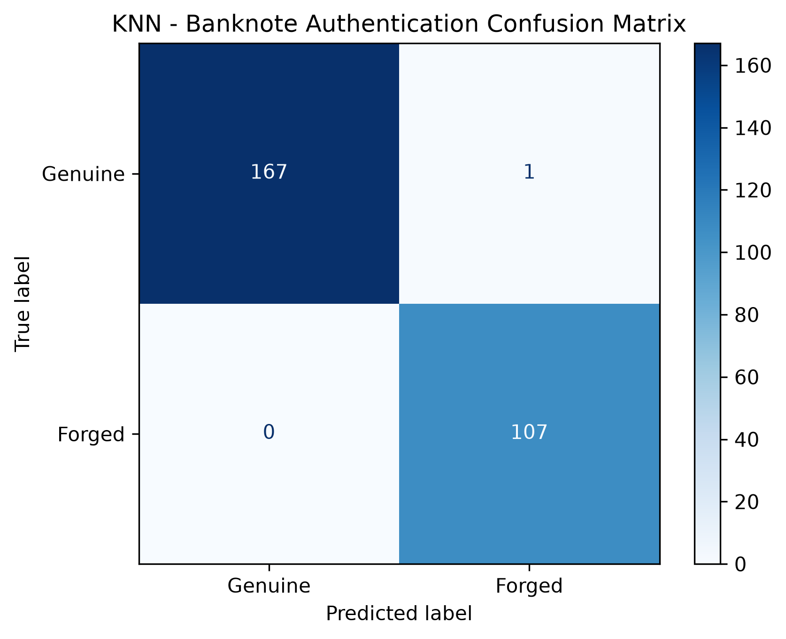
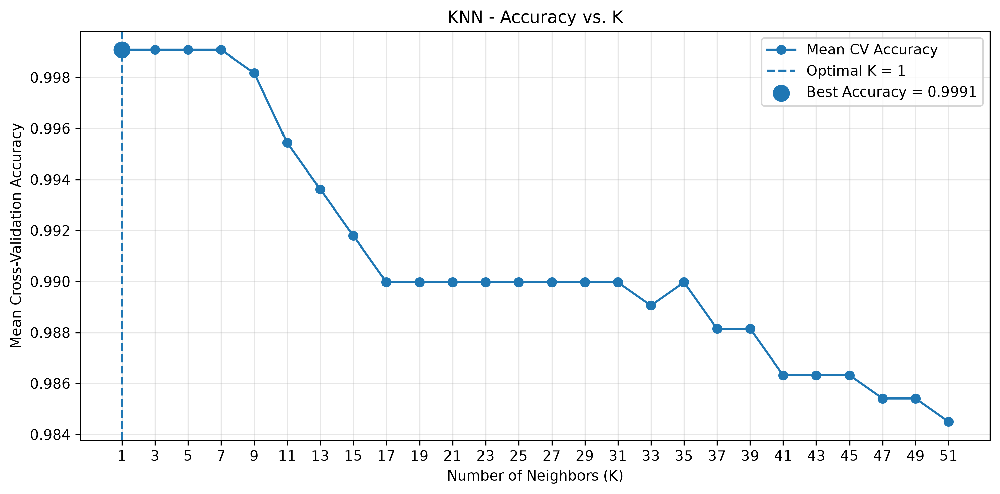

# Banknote Authentication using KNN

A beginner-friendly Machine Learning project using **K-Nearest Neighbors (KNN)** to classify banknotes as genuine or forged.

## Dataset

The dataset contains **1,372 rows, four input features, and one target class**.

- **Input features:** Variance, Skewness, Curtosis, Entropy
- **Target:** Class (`0` or `1`)
- **Representation:** An additional explanatory column where `0` means Genuine and `1` means Forged. This column was added for clarity and was **not used for model training**.

Dataset: [UCI Banknote Authentication](https://archive.ics.uci.edu/dataset/267/banknote+authentication)

## Workflow

- Loaded and explored the dataset.
- Split the data into training and testing sets.
- Scaled the input features using `StandardScaler`.
- Trained a KNN classifier using **K = 5**.
- Evaluated predictions using accuracy and a confusion matrix.
- Later explored cross-validation to understand how different K values perform.

## Results

- **Test Accuracy:** Approximately **99.636%** (`0.99636`).
- **K = 5:** Only one incorrect prediction on my test set.
- Cross-validation selected **K = 1** based on the highest mean validation accuracy.

The results can differ because cross-validation averages performance across multiple folds, while the test set represents one particular split.

## Visualizations

**Confusion Matrix**

**Accuracy vs. K**

## Technologies

Python · Pandas · NumPy · Matplotlib · Scikit-learn
